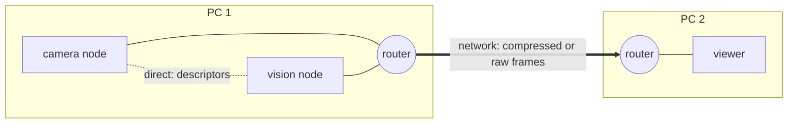

# Sessions and routers

A session is the connection of one program to Zenoh, the network layer below Durchblick. This page explains how
programs find each other without addresses, what the router does, and which four properties of Zenoh you must know
when you write a program.

## One router per PC

Every PC that runs Durchblick programs runs one Zenoh router on port 7447: `xblick router` or `zenohd`. A program that
opens a session without options connects to the router at `127.0.0.1:7447` and listens on a free loopback port.

The router works like a switchboard. It tells the programs of the PC about each other, and the programs then
connect directly. Zenoh calls this gossip scouting. The frames themselves do not pass through the router: on one PC
they travel through a [ring](rings.md), and only the descriptors travel from program to program.

In Zenoh's terms, the programs of one PC form a peer-to-peer region below their router. In such a region every peer
connects to every other peer. Zenoh calls this a clique. The router is the region's gateway to the routers of the other
PCs. It routes data between the PCs. It does not route data from one of its peers to another. Zenoh 1.9 removed that
function, which was called failover brokering.



This design has three consequences.

- No program needs the address of another program.
- Multicast scouting stays off, so the programs of two robots in one network do not find each other by accident.
- The reader decides between a ring and the network. It compares the publisher's host in `<stream>/info` with its
  own host. The router has no part in this decision.

## Start a router

Start `xblick router`, the router of the package, or `zenohd` 1.10, the Zenoh version of the Python and C++
packages. [Install](../getting-started/install.md#the-router) states where `zenohd` comes from and what
`xblick router` lacks.

```bash
# on a single PC
xblick router
zenohd --no-multicast-scouting -l tcp/0.0.0.0:7447        # or this

# on a PC of a group: one connection per other PC
xblick router --connect tcp/<other-pc>:7447
zenohd --no-multicast-scouting -l tcp/0.0.0.0:7447 -e tcp/<other-pc>:7447   # or this
```

Between PCs the data travels from router to router. A program on a host without a router reaches the programs of a PC
through `--connect <pc> --zenoh-mode client`. `<pc>` means port 7447 of that PC.

## Which mode when

| Setup | Options | What follows |
| --- | --- | --- |
| a router on every PC, programs as peers | none on the programs. On one PC of each pair: `xblick router --connect tcp/<other PC>:7447` | the standard. On one PC the frames travel through rings. Between PCs they travel from router to router. |
| a visiting program, for example a viewer on a laptop | `--connect tcp/<other PC>:7447 --zenoh-mode client` | The router of the other PC routes all its data. Nothing changes on that PC. |
| a peer on a PC without a router of its own | `--connect tcp/<other PC>:7447 --listen tcp/0.0.0.0:0` | Only on purpose. The peers there learn its address through their router and connect to it. Every program on that network can connect to it, and Zenoh in this setup has no access control. |
| two programs without any router, for example in a test | `--listen tcp/127.0.0.1:<port>` on one, `--connect tcp/127.0.0.1:<port>` on the other | They connect directly. |

A peer that connects only to another PC and listens on loopback only usually finds nothing. The programs of that
PC learn its loopback address and cannot connect to it. Every `xblick` command and every node says so in one line at
the start, with the three ways out from the table. The rule uses the options alone. It does not know whether the
programs of the other PC listen on network addresses, in which case the connection works. The terminal interface
refuses a peer that only connects.

## Other ways to connect

| You want | Use |
| --- | --- |
| the router of this PC | no option |
| the router of another PC | `--connect <host> --zenoh-mode client` |
| two programs without a router, for example in a test | explicit endpoints: `--connect` on one side and `--listen` on the other |
| full control | a Zenoh JSON5 file with `--config` (Python: `config_file`). It replaces all other options. |

**Through an SSH tunnel.** Forward the router of the server and connect as a client:

```bash
ssh -N -L 7447:127.0.0.1:7447 server
xblick list --zenoh-mode client --connect tcp/127.0.0.1:7447
```

You must use client mode here. A peer would learn the addresses of the other sessions, which are loopback addresses
of the server, and it could reach none of them.

## Order and restarts

Programs and routers start and stop in any order.

| Event | Behaviour |
| --- | --- |
| A program starts before its router | It waits and connects 0.6 s after the router started. |
| A router restarts | The programs find it again within one second. |
| A router is gone | The programs of one PC keep their direct connections. Data continued for 6 s without a router in our test. |
| A program restarts | The others find it again within 1.5 s. |

Tested with Zenoh 1.10.1 on one host on 2026-10-30, with up to three routers that connect to each other.

## Four properties of Zenoh that you must know

**Peers connect to each other directly.** A Zenoh 1.10 router does not route data between its peers, as
[One router per PC](#one-router-per-pc) explains. The router tells the peers each other's listen addresses. Zenoh calls
such an address a locator, for example `tcp/127.0.0.1:41464`. A Durchblick peer therefore always listens. With
`--connect` and without `--listen` it listens on a free loopback port, as without endpoints. Two consequences:

- A peer that connects to the router of another PC cannot reach that PC's programs through it, because they cannot
  connect to its loopback port. Connect as a client (`--zenoh-mode client`), or run a router on this PC as well and
  let the routers connect to each other. A third way is `--listen` on a network address, which opens the program to
  the whole network.
- A Durchblick session in client mode does not listen. Its router routes all its data.

**A query can stay open after its timeout.** A queryable ends its part of a query when it drops the query object. At the
query's timeout, the caller's own session ends a query that is still open. It then adds an error reply with the text
`Timeout`, and nothing comes over the network for it. Zenoh ends a query in this way in almost all cases. In one CI job,
a query with a timeout of 1 s was still open after 5 minutes. This is our observation, which Zenoh's documentation does
not describe. Code that iterates over the replies waits that long. Use `session.replies(session, selector, timeout,
...)` in Python or `xblick::replies` in C++. These functions return at a deadline with the replies that arrived. The
deadline is twice the timeout, and at least 0.5 s after the timeout. They count such queries (`session.not_finalized`,
C++ `queries_not_finalized()`) and log each selector once. The cost is small: 0.15 ms per query against 0.10 ms for the
direct iteration, measured on 2026-11-05 between two sessions over TCP.

**A new session needs time to learn about the others.** A query directly after `open_session()` may find nothing.
Durchblick's own queries repeat periodically. Do not query once and conclude that nothing is there.

**Closing can block.** After a query that Zenoh did not end, `close()` of a Zenoh session can block without limit. We
saw this in our tests. Zenoh's documentation does not describe it. The Python sessions from `open_session` and
`open_from_args` therefore close within 5 s and continue with a warning otherwise. This also holds at the end of a
`with` block. Wrap a session from your own `zenoh.open` call in `session.Session(...)`. C++ sessions close in the
destructor of `zenoh::Session` without such a limit. We have not seen the hang in C++, because the C++ programs never
query the router's admin space. A C++ program that does should close its session in a separate thread with a deadline.

## Related pages

- [Transports](transports.md): what a reader takes on the same host and across hosts.
- [Command line](../reference/cli.md): the connection options of every command.

## Status and limits

- Routers between two real PCs are not tested yet.
- A peer with `--listen tcp/0.0.0.0:0` that connects only to another PC is tested on one PC only. There a peer that
  listened on loopback only opened a link to the network address of the other peer, which it learned through the
  router. `--listen tcp/0.0.0.0:0` announces the addresses of the PC's network interfaces, not 0.0.0.0. Two real PCs
  were not tested.
