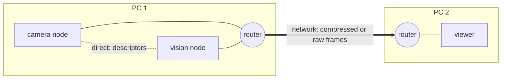

# Sessions and routers

A session is the connection of one program to Zenoh, the network layer below Durchblick. This page explains how
programs find each other without addresses, what the router does, and which four properties of Zenoh you must know
when you write a program.

## One router per PC

Every PC that runs Durchblick programs runs one Zenoh router, `zenohd`, on port 7447. A program that opens a
session without options connects to the router at `127.0.0.1:7447` and listens on a free loopback port.

The router works like a switchboard. It tells the programs of the PC about each other, and the programs then
connect directly. The frames themselves do not pass through the router: on one PC they travel through a
[ring](rings.md), and only the descriptors travel from program to program.



This design has three consequences.

- No program needs the address of another program.
- Multicast scouting stays off, so the programs of two robots in one network do not find each other by accident.
- The reader decides between a ring and the network. It compares the publisher's host in `<stream>/info` with its
  own host. The router has no part in this decision.

## Start a router

Start `xblick router`, the router of the package, or `zenohd` 1.10, the Zenoh version of the Python and C++
packages. [Install](../getting-started/install.md#the-router) states where `zenohd` comes from and what
`xblick router` lacks.

```bash
# on a single PC
xblick router
zenohd --no-multicast-scouting -l tcp/0.0.0.0:7447        # or this

# on a PC of a group: one connection per other PC
xblick router --connect tcp/<other-pc>:7447
zenohd --no-multicast-scouting -l tcp/0.0.0.0:7447 -e tcp/<other-pc>:7447   # or this
```

Between PCs the data travels from router to router. A program on another host reaches the programs of a PC through
`--connect <pc>`, which means port 7447 of that PC.

## Other ways to connect

| You want | Use |
| --- | --- |
| the router of this PC | no option |
| the router of another PC | `--connect <host>` |
| two programs without a router, for example in a test | explicit endpoints: `--connect` on one side and `--listen` on the other |
| full control | a Zenoh JSON5 file with `--config` (Python: `config_file`). It replaces all other options. |

**Through an SSH tunnel.** Forward the router of the server and connect as a client:

```bash
ssh -N -L 7447:127.0.0.1:7447 server
xblick list --zenoh-mode client --connect tcp/127.0.0.1:7447
```

You must use client mode here. A peer would learn the addresses of the other sessions, which are loopback addresses
of the server, and it could reach none of them.

## Order and restarts

Programs and routers start and stop in any order.

| Event | Behaviour |
| --- | --- |
| A program starts before its router | It waits and connects 0.6 s after the router started. |
| A router restarts | The programs find it again within one second. |
| A router is gone | The programs of one PC keep their direct connections. Data continued for 6 s without a router in our test. |
| A program restarts | The others find it again within 1.5 s. |

Tested with Zenoh 1.10.1 on one host on 2026-10-30, with up to three routers that connect to each other.

## Four properties of Zenoh that you must know

**A session that only connects does not listen.** If you give a peer session only `--connect` to a router, the
session does not listen, and the router does not route between such sessions. The programs then find nothing.
Either give no endpoints, or add `--listen tcp/127.0.0.1:0`, or connect as a client with `--zenoh-mode client`.

**A query can stay open after its timeout.** Zenoh ends a query after its timeout in almost all cases. In one CI
job, a query with a timeout of 1 s was still open after 5 minutes. Code that iterates over the replies waits that
long. Use `session.replies(session, selector, timeout, ...)` in Python or `xblick::replies` in C++. These
functions return at a deadline with the replies that arrived. The deadline is twice the timeout, and at least 0.5 s
after the timeout. They count such queries (`session.not_finalized`, C++ `queries_not_finalized()`) and log each
selector once. The cost is small: 0.15 ms per query against 0.10 ms for the direct iteration, measured on
2026-11-05 between two sessions over TCP.

**A new session needs time to learn about the others.** A query directly after `open_session()` may find nothing.
Durchblick's own queries repeat periodically. Do not query once and conclude that nothing is there.

**Closing can block.** After a query that Zenoh did not end, `close()` of a Zenoh session can block without limit.
The Python sessions from `open_session` and `open_from_args` therefore close within 5 s and continue with a warning
otherwise. This also holds at the end of a `with` block. Wrap a session from your own `zenoh.open` call in
`session.Session(...)`. C++ sessions close in the destructor of `zenoh::Session` without such a limit. We have not
seen the hang in C++, because the C++ programs never query the router's admin space. A C++ program that does should
close its session in a separate thread with a deadline.

## Related pages

- [Transports](transports.md): what a reader takes on the same host and across hosts.
- [Command line](../reference/cli.md): the connection options of every command.

## Status and limits

- Routers between two real PCs are not tested yet.
