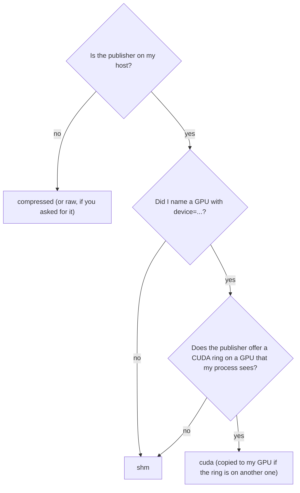

# Transports

A transport is the way in which a frame travels from a publisher to one subscriber. A publisher offers several
transports for the same stream, and each subscriber chooses one. This page explains the transports, how `auto`
chooses, and why a publisher does no work for a transport that nobody uses.

## The five transports

| Transport | How the frame travels | Use it |
| --- | --- | --- |
| `compressed` | JPEG, PNG or RVL over Zenoh ([codecs](#the-codecs-of-compressed)) | between hosts, over Wi-Fi |
| `raw` | uncompressed pixels over Zenoh | between hosts on a fast network |
| `shm` | a [host ring](rings.md) in shared memory | on the publisher's host, for work on the CPU |
| `cuda` | a [CUDA ring](gpu-frames.md) in GPU memory | on the publisher's host, for work on a GPU |
| `auto` | the best of the above for this subscriber | in almost every program |

A frame from a CUDA ring is a device array. A frame from every other transport is a NumPy array.

Point cloud streams have the same transports. Over the network a point cloud travels whole as a `PointCloud2`
message (`raw`), or as its ranges and colours (`compressed`) where its publisher has
[rays](#compressed-point-clouds).

> **The default of `ImageSubscriber` is `compressed`.** Pass `transport="auto"` to get a ring on the publisher's
> host. The command line tools and the nodes use `auto`.

## The codecs of `compressed`

The publisher chooses the codec of its stream with `codec`. A subscriber reads all three.

| Codec | Images | Loss | Use it |
| --- | --- | --- | --- |
| `jpeg` | 8-bit colour and grey | lossy | for colour. This is the default. |
| `rvl` | 16-bit grey and depth | lossless | for depth |
| `png` | 8-bit colour and grey, 16-bit grey and depth | lossless | for label images, and for colour that must stay exact |

RVL is a codec for depth images by Wilson (2017). It stores a run of empty pixels as its length and every other
pixel as its difference to the pixel before. We measured both codecs on 40 depth images of a Kinect v2 (SUN RGB-D,
730 × 530 pixels), on one thread:

| Codec | Encode | Decode | Size |
| --- | --- | --- | --- |
| `png`, zlib level 1 | 12.3 ms | 4.2 ms | 40 % of the pixels |
| `rvl` | 1.3 ms | 1.1 ms | 31 % of the pixels |

A label image has large areas of one value. There PNG is smaller than RVL, which needs half a byte for every pixel
that is not 0.

## Compressed point clouds

A point of a cloud is 16 bytes: `x`, `y` and `z` as 32-bit floats and the colour. The cloud of a camera has one
point for each pixel, and a pixel always looks along the same ray. `x` and `y` therefore follow from `z` and the
pixel, and `z` holds a 16-bit measurement. Of the 16 bytes, 5 carry information.

The `compressed` transport of a point cloud stream sends these 5 bytes as two images:

- the **range** of each point along its ray, as a 16-bit image in steps of `range_step` (1 mm by default), encoded
  with RVL. 0 means no point.
- the **colour** of each point, as a JPEG of quality 95 by default.

The **rays** are a table with one direction for each point. A point is its ray's direction times its range. The
publisher sends the table once to each subscriber, which asks for it on `<stream>/cloud/rays`. Every cloud names
its table, so a subscriber notices a new one.

The publisher gets the table from its program and knows nothing else about the origin of the cloud:

| Origin of the cloud | Ray of a point | Range |
| --- | --- | --- |
| a camera, with any lens | (`x/z`, `y/z`, 1) of its pixel | `z` |
| a laser scanner | the unit vector of its beam | the distance along the beam |

```python
publisher = PointCloudPublisher(session, "test/camera/points", fields=XYZRGB[0], point_step=16,
                                frame_id="depth_camera", rays=rays)       # rays: height x width x 3, float32
subscriber = PointCloudSubscriber(session, "test/camera/points")   # auto: compressed on another PC
```

A subscriber with `auto` on another PC takes `compressed` where every publisher of the stream offers it, and `raw`
otherwise. `remote="raw"` asks for the whole cloud.

We measured 40 clouds of a Kinect v2 (SUN RGB-D, 730 × 530 points, 6.19 MB each) in Python on one thread:

| Colour | Size of a cloud | Encode | Decode |
| --- | --- | --- | --- |
| JPEG, quality 85 | 0.30 MB | 4.9 ms | 3.6 ms |
| JPEG, quality 95 | 0.33 MB | 5.0 ms | 3.8 ms |
| PNG | 0.68 MB | 21.7 ms | 10.1 ms |

What the transport changes in a cloud:

- A range is rounded to `range_step`. A cloud computed from depth in millimetres comes back with the same
  coordinates but for the rounding of a float.
- JPEG changes the colours. `color_codec="png"` keeps them exactly and is slower.
- A range must fit 16 bits: 65.5 m at a step of 1 mm.

What it cannot send:

- A cloud whose points do not lie on fixed rays: a map, tracked points, or a cloud transformed into another frame
  than the one of its rays. Such a stream has no rays and offers `raw` only.
- Fields other than `x`, `y`, `z` and `rgb`.

The publisher checks every cloud against its rays. A cloud that does not lie on them raises an error, because the
subscriber would otherwise get shifted points.

The point cloud node passes the rays of its depth camera to its publisher
([point clouds](../guides/point-clouds.md#read-a-cloud)). In C++ the rays are `CloudPublisherOptions::rays`.

An RVL message is the message that ROS's `compressedDepth` plugin writes for a `16UC1` image with its format `rvl`:
the `format` field is `16UC1; compressedDepth rvl`. Durchblick reads nothing else of that plugin. A Durchblick older
than 0.3.62 does not read RVL and stops with an error on such a stream.

## How `auto` chooses

Every publisher answers a query on `<stream>/info` with its host, its transports and its GPU. A subscriber with
`auto` reads these records when it finds a publisher. It reads them again whenever a publisher of the stream starts
or stops, and changes its transport if the answer is now different.



On the publisher's host, the option `local` can narrow the choice. Python subscribers, `RGBDInputs` and the nodes'
`--local` option accept it. In C++ it is `SubscriberOptions::local`.

| `local` | The subscriber takes |
| --- | --- |
| `auto` (default) | the CUDA ring if the subscriber's process sees the ring's GPU, otherwise the host ring |
| `shm` | the host ring |
| `cuda` | the CUDA ring if the publisher offers one, otherwise the host ring |

A subscriber without a `device`, or with `device="cpu"`, works on the CPU. It takes the host ring even when the
publisher has a CUDA ring on a GPU of this host. A node that needs device arrays and gets the host ring with
`--local cuda` stops at its first frame with an error (`camera.check_local`).

A subscriber tells you what it chose and why. Python has `describe()` and `transport_reason`, C++ has
`transport_reason()`, and every node prints the choice in its start log:

```
cuda (publisher on this GPU)
cuda (copied from the publisher's GPU 7bce07b5)
shm (publisher's ring is on GPU 7bce07b5, which this process does not see)
shm (publisher offers no CUDA ring)
```

## The order of starting does not matter

A subscriber with `auto` keeps its choice up to date while it runs. Each publisher holds a Zenoh [liveliness
token](https://docs.rs/zenoh/1.10.1/zenoh/liveliness/index.html) for its stream, and Zenoh tells the subscribers when a
token appears or disappears. This also covers a publisher that crashes.

Two examples:

- A node reads a stream from another PC as `compressed`. Later a [relay](#relays) starts on the node's PC. The node
  moves to the relay's ring.
- The relay stops. The node moves back to `compressed`.

While a subscriber moves, it reads the old and the new transport side by side until the first frame arrives on the
new one, for at most 2 s. The frames of one stream have the same header on every transport, and the subscriber
compares their stamps. The stamps that it hands out during a move only grow, except after a restart of the stream.
The node therefore sees no frame twice and none out of order. A relay's ring lags the network, so the first frames
of the new transport can be ones that the old transport handed out already. The subscriber leaves them out until a
newer frame comes, for at most 2 s. A stamp on the new transport more than 2 s behind the newest one counts as a
restart of the stream, for example of a simulation. The subscriber hands such a frame out at once. A frame can be
lost when the new transport is ahead of the old one. The subscriber stops reading the old transport at the
first frame of the new one, so the frames that the old transport still had to bring do not arrive.

A node can therefore receive a NumPy array from one frame and a device array from the next. The helpers in
`xblick.tensors` accept both.

## A publisher works only on request

Zenoh's [matching status](https://docs.rs/zenoh/1.10.1/zenoh/matching/index.html) tells a publisher whether a subscriber
exists for a topic. A Durchblick publisher uses this for every transport separately.

- It encodes a JPEG only while a subscriber asks for `compressed`.
- It writes a ring only while a reader has the ring open.
- It sends nothing while no subscriber exists.

A producer can ask the publisher before it does expensive work. A simulation skips the rendering of a camera that
nobody reads:

```python
if camera.subscribed:
    camera.publish(render(), stamp_ns=capture_time_ns)
```

`xblick list` follows the same rule. It queries the `info` records and subscribes to nothing, so it causes no
work in any publisher.

The rule also covers cameras that deliver JPEG themselves. The publisher passes the camera's JPEG to `compressed`
subscribers unchanged and decodes it only when a subscriber asks for pixels. For the Azure Kinect's colour image at
2160p, passing the JPEG on takes 0.02 ms per frame. Decoding it on the GPU for a pixel subscriber takes 4.7 ms.

## Relays

A ring exists only on the publisher's host. A stream from another PC therefore arrives as `compressed` or `raw`,
and every subscriber decodes it on its own.

A relay removes this repeated work. You start one
[xblick-relay](https://github.com/xblick/xblick-relay) on each PC whose nodes read streams
from other PCs. For each such stream, the relay subscribes to it once, decodes each frame once and publishes it
under the same name into rings on its own host. It keeps the header, the sequence number and the source of every
frame. Its `info` record says `relayed_from: <host>`.

You do not tell the relay which streams to relay, and you do not change the readers.

1. A subscriber with `auto` reads a stream whose source has no ring on the subscriber's host. It reads the stream
   over the network and holds a liveliness token `<stream>/want/<host>/<id>`.
2. The relay on that host sees the token and starts to relay the stream.
3. The subscriber sees the relay's rings and moves to them, as described in
   [The order of starting does not matter](#the-order-of-starting-does-not-matter).
4. When the last such subscriber on the host has stopped, the relay stops relaying the stream.

Without a relay on the host, nothing follows from the token, and the subscriber keeps the network transport.

A subscriber on any other host takes the network transports of the original publisher, or the rings of the relay on
its own host. A relay never relays a stream that is already relayed.

## Related pages

- [Rings](rings.md) and [Frames on the GPU](gpu-frames.md): the two local transports in detail.
- [Latest value](latest-value.md): why a stream drops frames.
- [Sessions](sessions.md): how programs on several PCs find each other.

## Status and limits

- You start the relay of a PC yourself with `xblick relay`, for example beside the PC's router.
- Only a subscriber with `auto` asks the relay. For a subscriber with a fixed transport, name the stream with the
  relay's `--stream` option.
- The relay handles image streams. A point cloud from another PC arrives [compressed](#compressed-point-clouds)
  where its publisher has rays, and whole otherwise. Each reader decodes it for itself.
- A subscriber with a fixed transport (`shm`, `cuda`, `compressed`, `raw`) never changes it.
- A publisher without a liveliness token is found when a subscriber starts, but a later change of it is not noticed.
  Every publisher of this library has the token. A camera program
  outside this library may have none.
- We tested the change of transport with publishers on one machine, not between two PCs.
- After a move, the subscriber leaves out every frame whose stamp equals the newest one it handed out, or lies at
  most 2 s behind it, for up to 2 s. A stream whose frames carry one stamp on purpose therefore pauses for up to
  2 s. So does a stream that restarts less than 2 s of stamp time back.
- Copies on the new transport more than 2 s behind the newest frame count as a restart, and the subscriber hands
  them out again. A relay that queued frames while it started would cause this. The stamps alone cannot tell such
  copies from a restart.
- A new transport that delivers one frame behind the old one and then pauses for more than 2 s hands out older
  frames again when it resumes. The node then sees a frame twice, or out of order.
