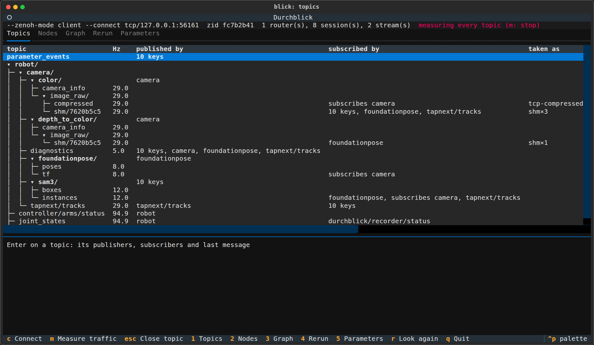
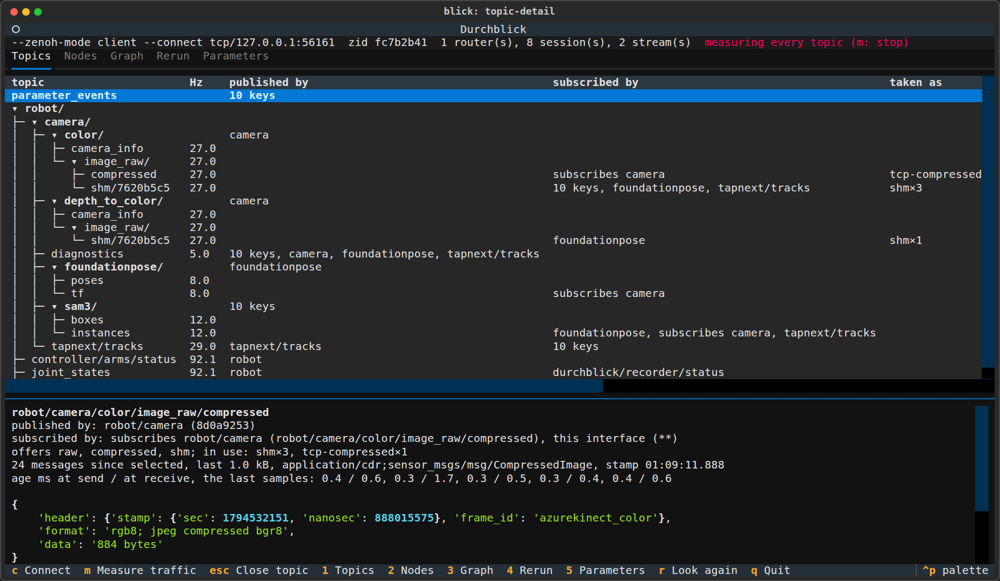
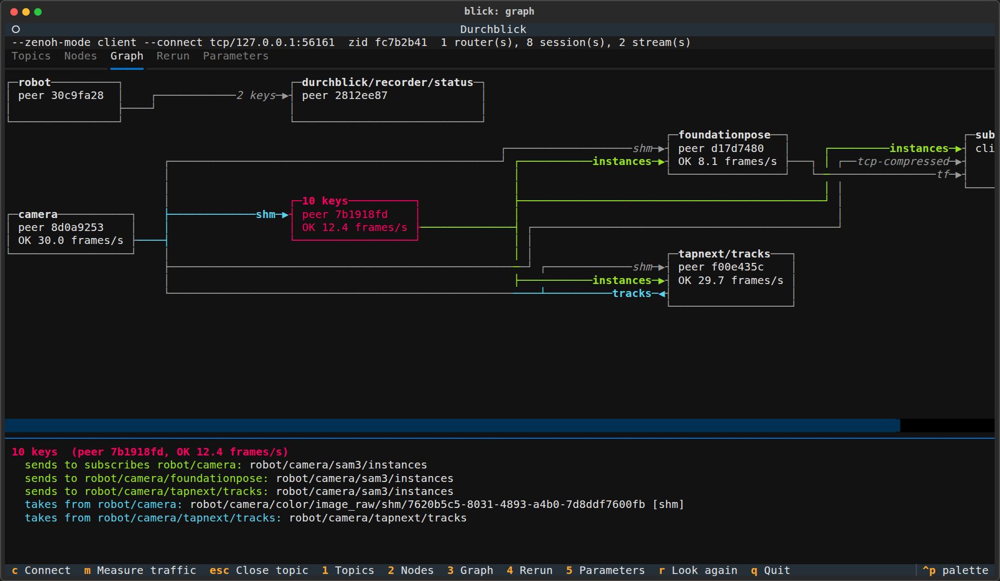
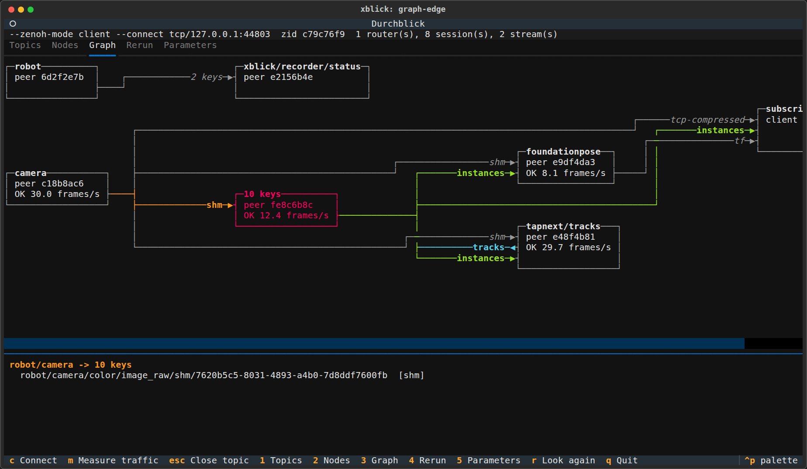
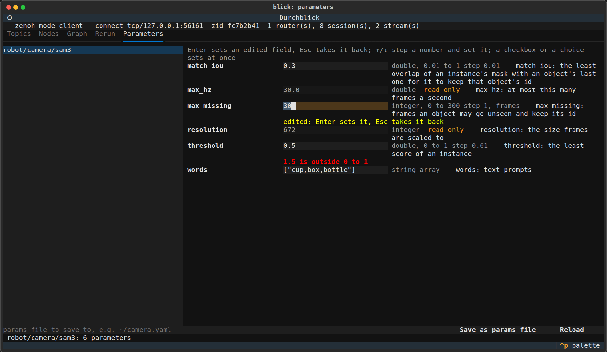
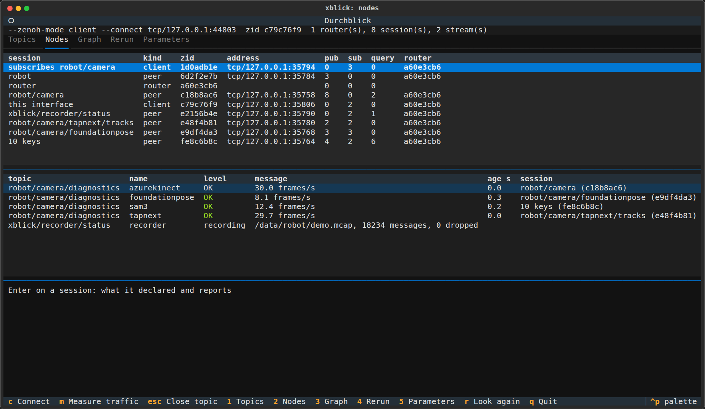
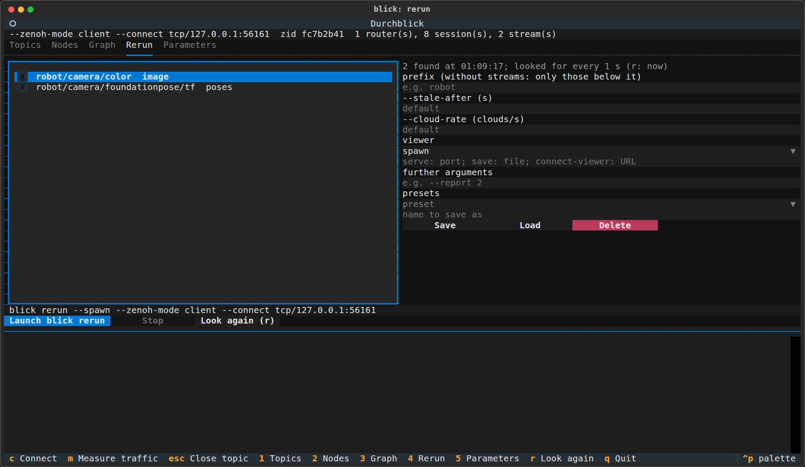
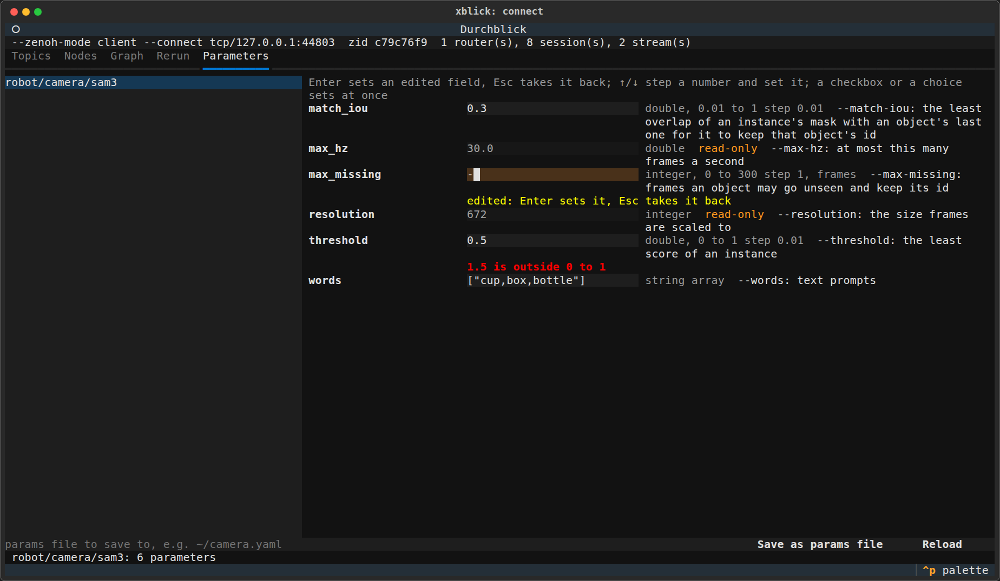

# Terminal interface

`xblick` without a command opens a terminal interface. It shows every topic, node and parameter that the
routers and the topics report, and it starts the viewer. It needs no knowledge of any particular node.

```bash
xblick
```

The interface needs a terminal of at least 80 x 24 characters. Without a terminal, for example in a pipe or a
service, the command refuses with a message.

The screenshots on this page show a network that `tools/tui_screenshots.py` makes up: an Azure Kinect, SAM 3,
FoundationPose, TAPNext, a robot state bridge, a recorder and a viewer. The script regenerates them after a change
to the interface.

## Tabs

| Tab | Content |
| --- | --- |
| Topics | every key that a session publishes, as a tree. `m` measures all of them: rate, size, type, last stamp and age. Enter on a topic subscribes to it alone and shows its publishers, its subscribers, the info record of the stream, and its last message decoded. |
| Nodes | the sessions, one per program, with kind, address and counts. The routers. The reports on every `<camera>/diagnostics`. The status of the record and play nodes. |
| Graph | the sessions as boxes and the data between them as arrows. A selected session shows what it sends and takes, and the mouse over an edge shows its keys. |
| Rerun | the streams, results, label images and pose topics that were found, and the options of `xblick rerun`. The tab builds the command line and checks it with the command's own parser. "Launch" runs it as a child process, and "Stop" sends it SIGTERM. "Look again" (`r`) searches for streams at once instead of at the next period of 2 s. |
| Parameters | the nodes that offer parameters, and a form built from the descriptors of the chosen node: numbers with range, step and unit, a switch for a boolean, a selection for choices. Read-only parameters are marked. A refused change shows its reason under the field. The node's events keep the values current. "Save as params file" writes them. See [parameters](../reference/parameters.md). |

### Topics



The first column is the key tree. A prefix with a single child and no key of its own joins that child, for example
`depth_to_color/image_raw/shm/0c9a1f6e`. The last part is the host of the ring, shortened to 8 characters. Enter on a prefix folds it and shows the number of keys below it. Enter again
unfolds it.

The columns "published by" and "subscribed by" name the sessions. A name stands on the highest row below which
every key has the same sessions, and the keys below that row leave the cell empty. In the screenshot, `azurekinect`
stands once on `color/`, and `diagnostics` lists every session that reports on it. The names are short: a session
is named without the name of the session whose name is a prefix of its own, so `test/camera/sam3` becomes
`sam3`. The Nodes tab and the detail panes show the whole names.

The column "Hz" stays empty until something subscribes: `m` for all topics, or Enter for one. A node's own rate
is in its diagnostics report, which the Nodes tab and the boxes of the graph show. These rates cost nothing,
because the interface subscribes to the diagnostics in any case. A node reports one rate, so the interface does not
assign it to the node's keys.



### Graph



A session that takes data from another stands in a column to the right of it. Each edge enters its box on a row of
its own. The label before the arrow is how the data is taken (`shm`, `cuda`, `tcp-compressed`), the key's last
token, or the number of keys. A box shows the kind and zid of the session and the reports that it sends on
diagnostics, for example `OK 12.4 frames/s`.

The arrow keys or a click select a session. Its outgoing edges turn green and its incoming edges cyan, and the pane
below lists the keys of each. The mouse over an edge shows the keys of that edge and how each is taken.



Two sessions that take each other's data form a cycle. The graph draws one edge of the cycle against the flow,
and its arrow `◀` points out of the box on its right side. In the screenshot, SAM 3 takes TAPNext's tracks, and
TAPNext takes SAM 3's instances. The graph leaves out the routers and the interface itself.

The drawing follows Sugiyama's layered layout in a small form. Netext (a Python library that draws graphs with
Rich) was considered, and the interface does not use it. It would add a dependency with a Rust part, and its
documentation describes neither edge routing nor interaction.

### Parameters



A node opens when it is highlighted in the list on the left. Each parameter takes one line: its name, its field, and
what its descriptor says. On a terminal narrower than 120 columns the descriptor's text stands under the field.

| Key | Action |
| --- | --- |
| Enter | set the edited field |
| Esc | take the edit back |
| ↑, ↓ | step a number by the step of its range, and set it at once. Without a step, an integer steps by 1 and a double by a hundredth of its range. |
| Space | toggle a checkbox, which sets it at once |

A field that is edited and not yet set has a yellow background. Under a field stands the node's reason for a
refused change, or "set" for two seconds after a change is taken. A field with the cursor keeps what is typed while
the node reports other values.

Every node offers its command-line options as parameters. The live ones change while the node runs, and the others
are read-only and apply at the next start. The node's README names its live parameters.

### Nodes and Rerun





## Keys

| Key | Action |
| --- | --- |
| `1` to `5` | select a tab |
| arrows, Enter | move in the table, tree or list of the tab, open a topic or a session, fold a prefix of the topics |
| arrows, click, mouse | in the graph: select a session, show an edge |
| `m` | measure all topics |
| `r` | search the network again now |
| `Esc` | close the topic |
| `c` | connect again |
| `q` | quit |

On a terminal narrower than 120 columns, the lists of the Rerun tab stand one above the other, and the tables
scroll sideways.

## Connect

The interface connects like every command: without options to the router of this PC. `c` opens a dialog to connect
again, to this PC's router, to endpoints, or through a Zenoh configuration file. The dialog opens with the cursor in
the address field, so an address and Enter are enough. An address without a protocol takes `tcp/`, and an address
without a port takes 7447: `robot-pc` connects to `tcp/robot-pc:7447` as a client. Typing into a field selects
that field's way of connecting. The commands' `--connect` and `--listen` take the same short forms.

When the interface starts on this PC's router and finds nothing there, it opens the dialog by itself. This happens
when no router answers or no other session is attached.



```bash
xblick --connect <host>              # tcp/<host>:7447, as a client: everything through that router
xblick --config FILE
```

With `--connect`, the interface is a client by default. Add `--listen` or `--zenoh-mode peer` to make it a peer. A
peer that only connects would receive nothing, so the interface refuses this combination and states the reason.

### Over SSH

Run these commands on your own computer, with Durchblick installed there:

```bash
ssh -N -L 7447:127.0.0.1:7447 server
xblick --connect tcp/127.0.0.1:7447
```

The interface must be a client here. A peer would see the sessions and could not reach them, because the router
gives it loopback addresses of the server. In that case the interface says "not reachable from here". To view
streams through the tunnel, give `xblick rerun` the same options: `--zenoh-mode client --connect
tcp/127.0.0.1:7447`. It then receives compressed images.

## How the interface knows what it shows

**Sessions and the graph** come from the admin space of the routers, which `zenohd` serves read-only by default.
When the interface is connected only to peers, it says that no router answered, and it shows only streams and
traffic.

**Names.** The admin space knows declarations and no names. The interface therefore names a session after the
common prefix of its keys, for example `test/camera/sam3`.

**Diagnostics.** The reports of several nodes on one camera share `<camera>/diagnostics`. Each sample names its
session in the attachment field `zid`, so each report appears under its session. A sample without this field
appears as "unknown".

**How a stream is taken.** The column "taken as" shows the transport of each consumer.

| Value | Meaning |
| --- | --- |
| `shm`, `cuda` | the consumer reads the ring on the publisher's host |
| `<protocol>-raw`, `<protocol>-compressed` | the consumer receives the frames over Zenoh. The protocol is that of its link to its router, such as `tcp`, `udp` or `unix`. |
| `unknown` | the routers know no link of this session. The interface states the reason. |

For a network transport, the interface also shows the address that the router sees and the path of the data. The
data of a client pass through its router. Between peers the admin space shows no links, so the interface makes no
claim about the path of a peer. Beside the value, it lists the transports that the stream offers.

**Measuring costs work.** `m` subscribes to every topic, as `xblick list --traffic` does. All publishers then
produce every representation, including raw images, while the measurement runs.

## Presets

The Rerun tab stores named presets in `~/.config/xblick/rerun_presets.json`, or below `$XDG_CONFIG_HOME`. A
preset contains its streams, its options and its Zenoh connection. Loading a preset connects to its connection.
