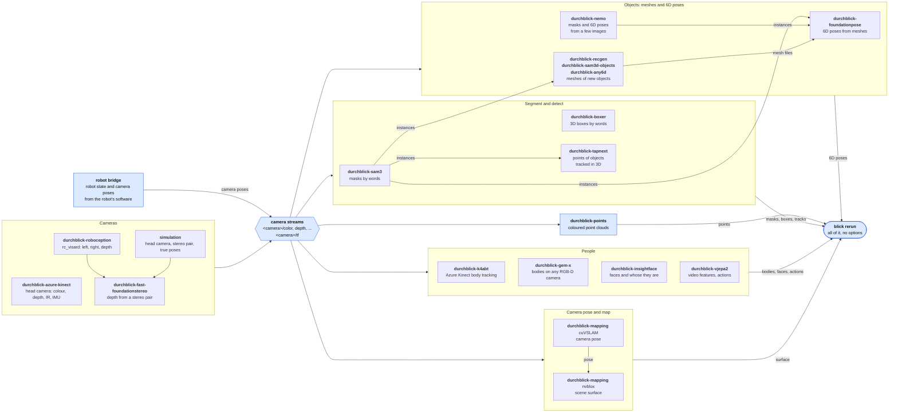

# Nodes

The perception nodes of Durchblick: how data flows between them, what each node publishes, how much GPU memory and
load each needs, and how five pose nodes compare on a turntable.

Each method is a node in a repository of its own. A node reads the streams of a camera and publishes its results
below the camera at `<camera>/<node>/<name>`. Durchblick itself contains the transport, the point cloud node, the
recorder and the viewer.

## Data flow

## Catalogue

Topics are relative to `<camera>/`.

| Repository | Method | Publishes |
| --- | --- | --- |
| [durchblick-azure-kinect](https://github.com/xblick/durchblick-azure-kinect) | the Azure Kinect camera. `durchblick-k4abt` adds its body tracking. | `color`, `depth`, `depth_to_color`, `ir`, `imu`, `bodies` |
| [durchblick-roboception](https://github.com/xblick/durchblick-roboception) | the Roboception rc_visard stereo camera | `left`, `right`, `depth` |
| [durchblick-relay](https://github.com/xblick/durchblick-relay) | the streams that nodes on this PC read from other PCs, in the rings of this PC. One relay per PC. | each relayed stream under its own name |
| a simulation | head camera, stereo pair, true object poses | the topics of the robot's cameras, `sim/objects/tf` |
| `durchblick-fast-foundationstereo` | depth from a stereo pair (Fast-FoundationStereo) | `ffs/depth`, `ffs/disparity` |
| `durchblick-points` (this repository) | coloured point clouds from depth and colour | `points` |
| [durchblick-sam3](https://github.com/xblick/durchblick-sam3) | masks of what words name (SAM 3.1) | `sam3/instances`, `sam3/detections_2d` |
| [durchblick-boxer](https://github.com/xblick/durchblick-boxer) | 3D boxes of what words name (Boxer) | `boxer/boxes_3d`, `boxer/detections_2d` |
| [durchblick-tapnext](https://github.com/xblick/durchblick-tapnext) | points on the objects of durchblick-sam3, tracked frame by frame and lifted to 3D (TAPNext++) | `tapnext/tracks` |
| `durchblick-foundationpose` | 6D poses of objects with a mesh (FoundationPose) | `foundationpose/detections_3d` |
| [durchblick-nemo](https://github.com/xblick/durchblick-nemo) | masks and 6D poses of objects from a few images of them (NeMO) | `nemo/detections_3d`, `nemo/instances`, `nemo/detections_2d` |
| `durchblick-ivt` | localisation of textured objects from a stereo pair (IVT) | see its README |
| `durchblick-recgen`, `durchblick-sam3d-objects`, `durchblick-any6d` | meshes of new objects from views of a camera, for FoundationPose | mesh files, on request |
| [durchblick-gem-x](https://github.com/xblick/durchblick-gem-x) | bodies of people on any RGB-D camera (GEM-X), in the format of the Azure Kinect tracker | `gem_x/bodies` |
| `durchblick-insightface` | faces and their identities (InsightFace: SCRFD, ArcFace) | `insightface/detections_2d` |
| [durchblick-vjepa2](https://github.com/xblick/durchblick-vjepa2) | features of a video clip for action heads, and the actions of Something-Something v2 (V-JEPA 2) | `vjepa2/tokens`, `vjepa2/actions` |
| `durchblick-mapping` | the pose of the camera (cuVSLAM) and the surface of the scene (nvblox) | `vslam/odom`, `nvblox/surface` |
| `blick record`, `blick play` (this repository) | all of the above into MCAP files and back onto the topics | `durchblick/recorder/status` |

A bridge to the robot's software publishes the robot state and the camera poses.

## GPU memory and load

Each node ran alone on one GPU with a 1280 x 720 camera at 30 frames per second.

| Node | VRAM (GiB) | GPU load | Results per second | Condition |
| --- | --- | --- | --- | --- |
| `durchblick-sam3` | 4.7 | 59 % | 31 | four words, `--compile default` |
| `durchblick-boxer` | 1.7 | 34 % | 31 | four labels, `--features` |
| `durchblick-tapnext` | 2.5 | 24 % | 22 | on the objects of SAM 3, 363 tracks |
| `durchblick-nemo` | 2.3 | 1 % | 31 | on the instances of SAM 3, none of its objects in view (idle) |
| `durchblick-foundationpose` | 11.4 | 82 % | 22 | 2 objects tracked, on the depth of Fast-FoundationStereo |
| `durchblick-fast-foundationstereo` | 2.2 | 29 % | 30 | stereo pair, `--max-width 640` |
| `durchblick-gem-x` | 7.5 | 54 % | 20 | one person |
| `durchblick-insightface` | 1.3 | 6 % | 31 | no face in view, so detection only |
| `durchblick-vjepa2` | 1.4 | 48 % | 31 | clips of 16 frames at 8 frames per second |
| `durchblick-robot-mask` | 0.8 | 2 % | 30 | one robot model |
| `durchblick-nvblox` | 3.7 | 6 % | 32 | with the robot mask and the features of Boxer |
| `durchblick-vslam` | 1.9 | 2 % | 31 | `--slam` |
| `durchblick-points` | 0.5 | 2 % | 31 | one reader. Idle without a reader. |
| `durchblick-recgen` | 6.0 | 0 % | on request | holds its memory while it waits |
| `durchblick-sam3d-objects` | 12.3 | 0 % | on request | holds its memory while it waits |
| `durchblick-any6d` | 7.5 | 0 % | on request | holds its memory while it waits |

How we measured, on 2026-11-02:

- GPU: RTX PRO 6000 Blackwell Server Edition with 96 GB.
- Input: the head camera of the simulation, recorded and played with `blick play --loop`. The nodes that a
  node depends on ran on another GPU.
- VRAM is the value of the node's process in `nvidia-smi`.
- GPU load is the median of `utilization.gpu` over 60 s after a warm-up, with MPS off. This value is the share of
  time in which a kernel executes. A node at 50 % therefore does not use half of the GPU's throughput.
- The content of the scene decides much of a node's load. The column "Condition" states it.

The camera nodes and `durchblick-k4abt` are not measured, because they need the device. The default set of one
robot's vision setup (robot mask, Boxer, nvblox, SAM 3, Fast-FoundationStereo) holds 13 GiB.

## 6D object poses on a turntable

**Setup.** Five objects outside the YCB set stood on a turntable in the simulation: a spray bottle, a
gearbox shell, a hand-wash paste, a torch and a mounting adhesive. The table made one turn in 40 s. The left camera
of the simulated rc_visard saw the scene, with the depth of Fast-FoundationStereo. All five nodes ran live at the
same time, each on its own GPU. Every FoundationPose instance used the masks of NeMO (`segmenter=nemo`).

**Result.** 80 s, two turns, 801 images. ADD-S is the mean distance between the true mesh and the mesh at the
estimated pose, in mm.

| Node | Results/s | Latency | Objects found | Gearbox found | ADD-S at arrival: median (90 %) | ADD-S at its stamp |
| --- | --- | --- | --- | --- | --- | --- |
| NeMO, 3-4 images of each object | 10.0 | 95 ms | 98 % | 90 % | 3.4 (4.9) | 3.4 |
| FoundationPose, true scan | 9.6 | 151 ms | 97 % | 89 % | 3.0 (4.3) | 2.0 |
| FoundationPose, RecGen mesh (3 views) | 9.3 | 146 ms | 92 % | 70 % | 4.9 (8.6) | 4.8 |
| FoundationPose, SAM 3D mesh (1 view) | 9.4 | 145 ms | 90 % | 52 % | 4.8 (6.5) | 4.7 |
| FoundationPose, Any6D mesh (1 view) | 9.6 | 149 ms | 97 % | 88 % | 5.1 (6.8) | 4.7 |

**What the numbers show.**

- Every node kept up with the camera's 10 frames per second while it tracked all five objects. The latency is the
  time from the capture of the image to the arrival of the result. The stereo depth is computed first and counts
  into it.
- "At arrival" is the error that a consumer sees. The object moves during the latency. At 0.13 m from the axis it
  moves 2 mm in 100 ms. This explains most of the difference between 2.0 and 3.0 mm for the true scan.
- With a mesh from a mesh maker, FoundationPose is about 2 mm worse than with the true scan. It also loses the
  gearbox shell in a third (RecGen) to a half (SAM 3D) of the frames. The few views of the mesh makers see least
  of the shape of this object.
- NeMO uses no mesh, and its error lies between the two.

**Limits of the comparison.**

- The meshes are those of the rare-object comparison in the README of durchblick-recgen (anchor view 20).
- The object frames of the meshes and of NeMO differ from the frame of the true mesh. We mapped each node's pose
  of an object onto the true frame with one fixed transform per node and object. We chose the best of 30 candidates
  over the recording by median ADD-S, in the same way for every node.
- The comparison ran only in simulation. We recorded and scored it with scripts that we did not keep.
